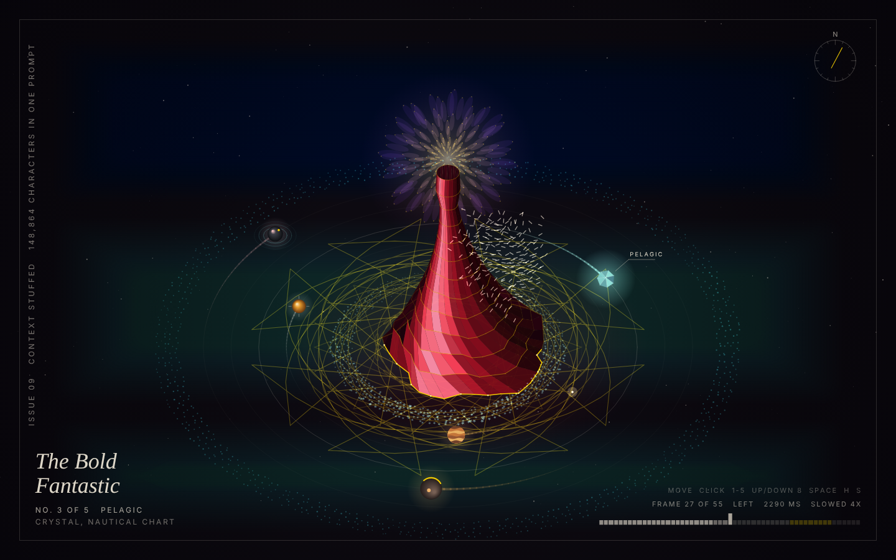

# Week 9 Studio + Build Notes: THE BOLD FANTASTIC

Steve Elias Oregel | CRCP 6330 Creative Coding for the Web | Nov 10, 2026

**Repo:** https://github.com/SteveElias78/bear-cave (branch `week9-context-stuffed-art`)
**Piece:** `art/week9-the-bold-fantastic/` (open `index.html`, or paste `sketch.js` into OpenProcessing)
**Status:** working, unfinished. See "What is still unfinished" at the bottom.

## What it is

An interactive p5.js magazine cover. A single red gown stands at the center of an orrery. Five planets orbit it, one for each of my spec brands, and each planet is made of that brand's material. A flock swarms the gown and a gold line embroiders the floor wherever the pointer goes.

## The creative process

My flavor going in was simple: visually dazzling, worthy of a final, push the complexity. I did not hand the model a concept. I handed it my whole curated context folder and let the evidence pick the concept.

Week 7's piece (Elemental Ribbons) was built through retrieval: 13 vector searches over 250-character chunks. That found the big themes, but small chunks cannot hold a number next to the sentence that explains it. This week I went the other way and stuffed the entire snapshot, 148,864 characters, into one prompt. The result is a piece built out of specifics that retrieval never surfaced:

| In the piece | Where it came from in my own files |
| --- | --- |
| Every ellipse is tilted by 0.654 | `Heavenly_Bodies.pde`: I pixel-measured the orbit at rx=347, ry=227, so PERSP=227/347 |
| The gown sweeps right, left, up, then settles | `RedDressFinal.pde`: frames 0-23 right, 24-39 left, 40-48 up, 49-54 settle |
| The timeline at the bottom, 55 bars of two widths | My Claude Code background-removal prompt: the real 40 ms and 50 ms frame delays, 2290 ms total |
| Flock forms a crescent on the trailing edge, bursts on the up-sweep | `RedDressFinal.pde` comments |
| The gown has 13 layers with gold on every one | `Mandala.pde`: 13-layer mandala, "keeping gold (#FFD700) on every layer" |
| The gold line never lifts and lags the pointer | Silvertrace README: stylus is "always touching", ~0.15 lerp per frame |
| That line is mirrored 3 to 12 times | `crystalline-kaleidoscope.pde`: segments 3-12, half of them flipped |
| Belt shards are jagged five-point stars | `poly.pde`: low inner ratio (0.35 to 0.5) so they read as rock |
| Compass needle sits at 30 degrees | The PELAGIC nautical chart flatlay |
| Only one thing is red | `about-steve.md`: "Restraint plus one bold move (a single red gown, a single gold accent)" |
| The cover line and title | My Tantalum cover, "The Bold Fantastic" |

All 15 decisions and their sources are written in the comment block at the top of `sketch.js`, along with a list of what the context could NOT supply.

## The technical process

1. **Context stuffing.** Used `prepared_context/course.txt` from Week 6 (my text files plus machine captions of every image). The model read all of it in one pass before writing any code. No vector DB, no graph, no MCP.
2. **Build.** One `sketch.js`, about 700 lines, p5.js 1.9.4, no assets and no other libraries. The gown is 13 rings of 34 points with painter's-order shading. The belt and outer ring are 2D grids like my Heavenly Bodies sketch. The flock is a boids simulation. The background is a Rothko-style color field rebuilt per brand world and cross-faded.
3. **Run and inspect.** The sketch was run in headless Chrome at 1440x900 and 1280x800, with scripted pointer movement, a click and a key press. Screenshots were taken and looked at after every change, and the console was checked for errors (none).
4. **Fix, rerun.** Three rounds. See failures below.

## How I got the AI tools to help

* **Curation did the heavy lifting.** The reason the model could find "PERSP=0.654" is that in Week 6 I wrote `code-digest.md`, the header comments from every sketch in my own words. My voice and my numbers were already in the context as text.
* **Direction over description.** I gave the model a flavor and a bar ("dazzling, final-project worthy") and made it justify every choice from my files. Anything it could not source had to be labeled as its own interpretation.
* **Made it look at its own work.** The model does not get to say "done" from reading code. It had to run the sketch, screenshot it, and react to what was on screen. Two of the three failures below were only visible in the screenshots.

## Failures and how they were overcome

1. **The type rendered tiny and plain.** The first run showed the masthead as a small sans-serif label instead of big cover type. Cause: the code passed a CSS font list (`Didot, "Bodoni MT", ...`) to p5's `textFont()`, which only accepts ONE family name, so it silently fell back to the default at the default size. No console error at all. Fix: a small `pickFont()` helper that passes one installed family name. That helper then had its own bug: `document.fonts.check()` answers yes for fonts that are not installed, so on my Windows machine the small labels came out in a serif. It now measures text width to detect a real install.
2. **The gown looked like a funnel.** The first silhouette had a long thin neck and swung so far sideways that it read as a vase tipping over, not a gown. Fix: shortened it, changed the flare curve and cut the sway by more than half. It still reads more like a couture cone than a body in a dress. That is the top item on the unfinished list.
3. **The golden ratio would have torn the fabric.** My mandala spins each layer at a golden-ratio speed in alternating directions. Applied to a connected gown, the layers twist against each other until the panels cross. Fix: the phi relationship moved from spin speed to the sway frequency of each layer, and the true counter-rotating phi spin lives in the halo above the gown, where the layers are not connected.
4. **The image captions lie.** The captions in my context were written by a local vision model and many are wrong: LEI WAI is read as "LELEI", "KATY" and "VIVI", and my Rothko recreation is captioned as containing "Steve Jobs". Stuffing everything means stuffing the errors too. Fix: file names and my own index were trusted over captions, and nothing in the piece depends on a caption alone except the compass angle.
5. **My context has no brand colors.** The only hex values in 148,864 characters are #FFD700 and the Silvertrace toy palette. Every planet and background color is the model's interpretation of phrases like "amber glass" and "desert strata". Same gap I hit in Week 7. It is labeled in the code so nobody mistakes it for my brand spec.
6. **I cut the masthead.** The model put a big TANTALUM masthead across the top, magazine style. I asked for TBF in italic instead, then looked at the piece running and decided to remove the masthead completely. It looks better with nothing written on top. That was an art direction call the context could not make for me.
7. **A fix that never arrived.** The model reported the masthead change as done, but my browser still showed the old one. The file copy to my laptop had silently delivered a stale version. Caught it because I looked at the running piece instead of trusting the report. Now every copy is verified with a checksum on my machine.
8. **Real time was too fast.** Played at the GIF's true 2290 ms loop, the gown and flock looked frantic. Slowed 4x, and the timeline says so on screen.

## Context stuffing vs. everything else I tried

| | Week 7 (MCP agent + vector search) | Week 9 (context stuffing) |
| --- | --- | --- |
| What the model saw | 13 searches, 250-character chunks | All 148,864 characters at once |
| What it was good at | Themes: mandala, prisms, murmuration, island chain | Specifics: measured ratios, frame tables, exact timings, direct quotes |
| Weak spot | Missed anything that needs two far-apart facts together | Takes in the noise too (bad captions), and only works because the folder fits in the window |

## What is still unfinished

* The gown needs a real figure: shoulders, a waist, a train.
* Performance is unverified on real hardware. Headless test runs (software rendering, no GPU) held 25 to 35 fps. The flock is the expensive part.
* Not tested on touch devices.
* Not yet posted to OpenProcessing.
* Brand colors should come from real brand specs, not interpretation.

## My reflection

[STEVE: two or three sentences in your own words. What surprised you about stuffing vs. retrieval? Would you direct it differently next time?]
